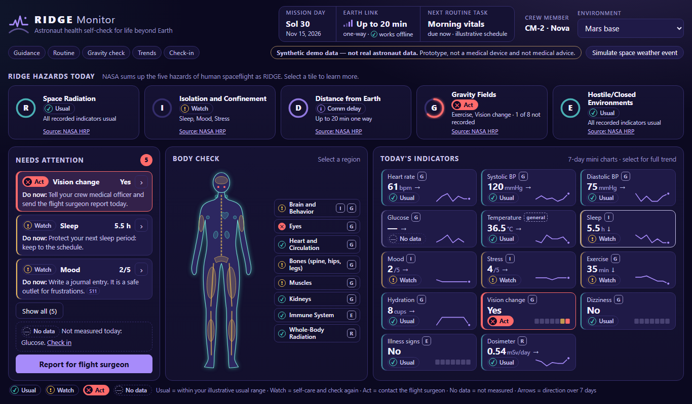
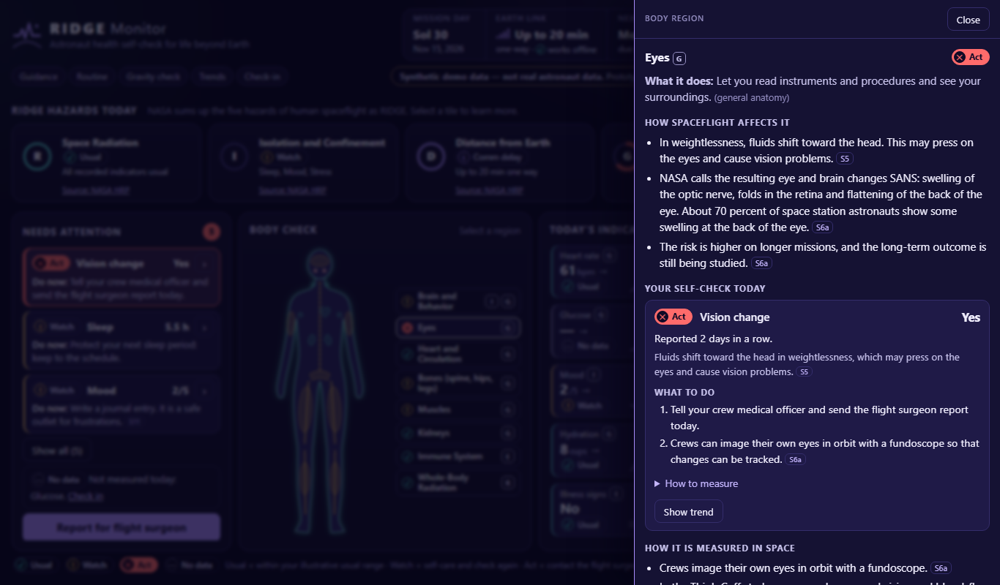
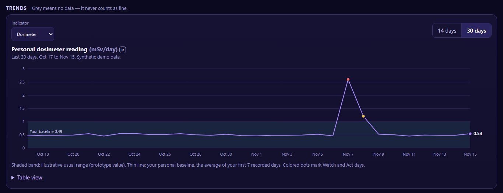
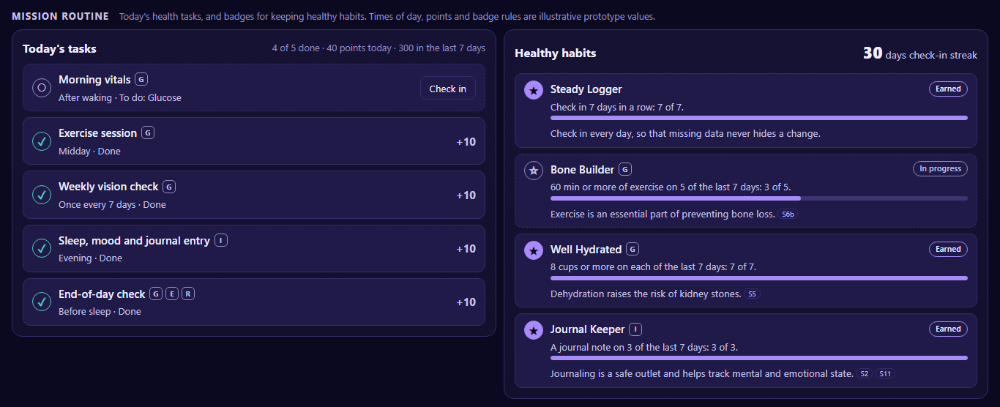
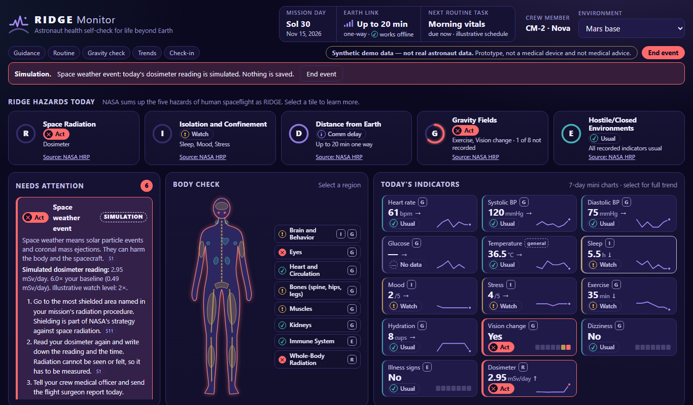
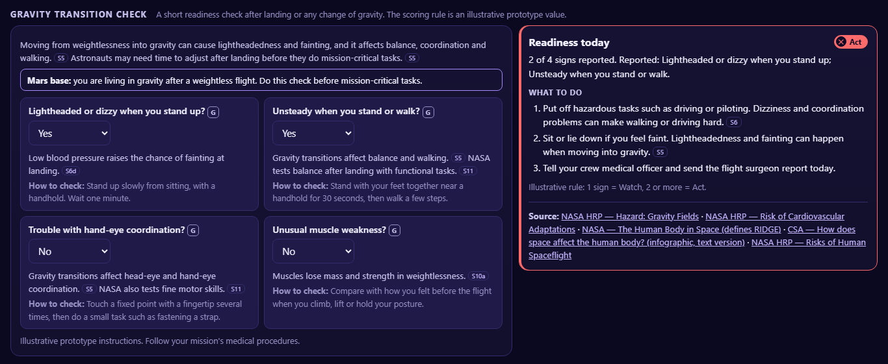

# RIDGE Monitor

**Astronaut health self-check for life beyond Earth.**

RIDGE Monitor is a hackathon prototype for the NASA Space Apps Challenge 2026, challenge *Create Health Monitoring Software for Astronauts on Space Missions*. Team **BAY ORBIT**, Tampa, FL.

> Prototype, not a medical device and not medical advice. Synthetic demo data only. Not affiliated with or endorsed by NASA.

## What it does

RIDGE Monitor is a visual tool that helps an astronaut check their own health each day and decide what to do next. It is laid out as a "mission control" dashboard: the header shows the mission day, the communication delay to Earth and the next routine task, and the main things fit on one laptop screen.

- **RIDGE strip.** NASA sums up the five hazards of human spaceflight with the acronym RIDGE: space **R**adiation, **I**solation and confinement, **D**istance from Earth, **G**ravity fields, and hostile/closed **E**nvironments. Each hazard has a tile with today's status and a source link. Every body region, indicator and alert is tagged with the hazard letters that affect it.
- **Needs attention.** One card lists every Watch and Act item with its main action.
- **Clickable body figure.** Eight regions: brain and behavior, eyes, heart and circulation, bones, muscles, kidneys, immune system and whole-body radiation. Regions are softly highlighted in their status color, and only Act items pulse. Each region opens a details panel that explains what the body part does, how spaceflight affects it, today's status, how to measure, what to do, and where the facts come from.
- **Daily check-in.** Fourteen indicators with plain-language instructions: resting heart rate, blood pressure, blood glucose, body temperature, sleep, mood, stress, a journal note, exercise, fluids, a vision self-check, dizziness, signs of illness and a personal dosimeter reading.
- **Indicator cards.** Each card shows today's value, a 7-day mini chart, a direction arrow and the status.
- **Color-coded status that is never color-only.** ✓ Usual, ! Watch, ✕ Act, — No data. Missing data is always shown as "No data" and never counts as fine. Where it makes sense, today's value is compared with the crew member's own baseline.
- **Guidance.** Every Watch and Act item gets clear next steps: self-care, prevention and when to escalate. There are no drug names, doses or diagnoses.
- **Escalation with communication delay.** "Prepare report for flight surgeon" builds a short text summary and shows the expected one-way delay for the selected environment.
- **Trend charts.** Hand-made SVG charts for the last 14 or 30 days, with the personal baseline, an illustrative usual range, a crosshair tooltip, keyboard support and a table view.
- **Environment selector.** Space station, spacecraft in transit, Moon base, Mars base and rover. The choice changes the communication delay and the gravity and radiation notes.
- **Space weather scenario.** "Simulate space weather event" shows what a radiation alert looks like: the dosimeter spikes, the R tile turns to Act and an event card lists the steps. It is clearly marked "Simulation", nothing is saved, and "End event" puts everything back.
- **Gravity transition check.** A four-question readiness checklist for the time after landing or any change of gravity: lightheadedness on standing, balance, hand-eye coordination and weakness. It gives a status and next steps, and it is highlighted for the Moon base, Mars base and rover.
- **Works offline.** The app keeps its own files on the device and opens with no connection. The header shows a "works offline" indicator.
- **Mission routine and badges.** Five daily tasks built from the check-in prompt the astronaut to take missing measurements. A check-in streak, points and four badges reward healthy habits such as exercise, drinking enough and journaling.

## Why it matters

On long missions astronauts carry much of the responsibility for spotting changes in their own health. NASA's Human Research Program describes why:

- **Radiation.** Space radiation is ionizing, cannot be seen or felt, and can damage DNA ([S1](https://www.nasa.gov/hrp/radiation/space-radiation-miniseries/)).
- **Isolation and confinement.** Sleep loss, a shifted body clock and work overload can reduce performance and health ([S2](https://www.nasa.gov/hrp/hazard-isolation-and-confinement/)).
- **Distance from Earth.** One-way communication delay at Mars can reach 20 minutes, so crews must handle medical situations with minimal help from the ground ([S3](https://www.nasa.gov/hrp/hazard-distance-from-earth/)).
- **Hostile/closed environments.** Stress hormone levels can rise and the immune system can change in a closed habitat ([S4](https://www.nasa.gov/hrp/hazard-hostile-closed-environments/)).
- **Gravity fields.** Weight-bearing bones lose on average 1% to 1.5% of their mineral density per month, fluids shift toward the head and may affect vision, and kidney stone risk rises ([S5](https://www.nasa.gov/hrp/hazard-gravity-fields/)).

## How to run

- **Online:** <https://helios84.github.io/ridge-monitor/>
- **Offline:** download the repository and open `index.html` in a browser. There is no build step and no install.

The app never contacts any other server. It uses no external scripts, fonts, CDNs, cookies or trackers. Check-ins are stored only in your browser (`localStorage`).

### Why it works offline

On a Mars mission the one-way communication delay can reach 20 minutes ([S3](https://www.nasa.gov/hrp/hazard-distance-from-earth/)), and crews must handle medical situations with minimal help from Earth. A health tool for that setting cannot depend on a connection. RIDGE Monitor therefore runs entirely on the device: opened as a local file it needs no network at all, and opened from the web address a small service worker (`sw.js`) saves the app's own files (`index.html`, `styles.css`, `app.js`, `data.js`, `favicon.svg`, `manifest.json`) so that the next visit works with no connection. The service worker handles only these files. "Reset demo data" at the bottom of the page restores the synthetic data.

## How the app answers the challenge questions

| Question from the challenge | Where the app answers it |
|---|---|
| Which measurements can be performed in space? | Each body-region panel has a "How it is measured in space" section with what NASA and CSA report: wrist activity trackers, attention self-tests, journaling, ultrasound, fundoscope eye imaging, urine, blood and saliva analysis, and radiation detectors. The check-in uses indicators a crew member can enter alone. |
| Why is an exam needed? | Every indicator shows a one-line reason with a source, in the check-in form, the body panel and the guidance cards. |
| How do spaceflight hazards affect these indicators? | RIDGE letters on every indicator and region, the "How spaceflight affects it" section in each body panel, and the RIDGE tiles that open a short explanation of each hazard. |
| When does a result warrant attention from the crew or flight surgeons? | Four statuses. Watch means self-care and check again. Act means contact the flight surgeon. The reason for each status is written next to it. The thresholds are illustrative prototype values kept in one object, `PROTOTYPE_ASSUMPTIONS`. |
| What actions can prevent a critical health condition? | "What to do" steps on every Watch and Act item and a "What helps" section in each body panel, for example exercise against bone loss, fluids against kidney stone risk, and lighting that follows a day-night cycle for sleep. |

Optional considerations covered: different environments (including a gravity transition check for the Moon and Mars), prompts to take measurements as part of a mission routine, gamification that encourages healthy tasks, dynamic charts, color coding, and simple instructions for people who are not medical experts.

## NASA and partner resources used

Every health fact in the app links to one of these public pages. The file [SOURCES.md](SOURCES.md) maps each feature to its hazard and source.

NASA Human Research Program and NASA:

- [Space Radiation](https://www.nasa.gov/hrp/radiation/space-radiation-miniseries/) (S1)
- [Hazard: Isolation and Confinement](https://www.nasa.gov/hrp/hazard-isolation-and-confinement/) (S2)
- [Hazard: Distance from Earth](https://www.nasa.gov/hrp/hazard-distance-from-earth/) (S3)
- [Hazard: Hostile/Closed Environments](https://www.nasa.gov/hrp/hazard-hostile-closed-environments/) (S4)
- [Hazard: Gravity Fields](https://www.nasa.gov/hrp/hazard-gravity-fields/) (S5)
- [Risks of Human Spaceflight](https://www.nasa.gov/hrp/risks/) (S6), with the risk pages for [SANS](https://www.nasa.gov/reference/risk-of-spaceflight-associated-neuro-ocular-syndrome-sans/) (S6a), [bone changes](https://www.nasa.gov/reference/risk-of-spaceflight-induced-bone-changes/) (S6b), [sleep and schedules](https://www.nasa.gov/reference/risk-from-inadequate-sleep-and-irregular-schedules/) (S6c) and [cardiovascular adaptations](https://www.nasa.gov/reference/risk-of-cardiovascular-adaptations/) (S6d)
- [5 Hazards of Human Spaceflight](https://www.nasa.gov/hrp/hazards/) (S7)
- [Ongoing HRP Research in Space](https://www.nasa.gov/hrp/ongoing-hrp-research/) (S8), with the study pages for [Standard Measures](https://www.nasa.gov/reference/standard-measures/) (S8a), [ARCHeR](https://www.nasa.gov/reference/archer/) (S8b) and [Thigh Cuff](https://www.nasa.gov/reference/thigh-cuff/) (S8c)
- [The Human Body in Space](https://www.nasa.gov/humans-in-space/the-human-body-in-space/) (S11), which defines the RIDGE acronym

Canadian Space Agency:

- [Monitoring radiation for astronaut health](https://www.asc-csa.gc.ca/eng/news/articles/2026/2026-02-26-monitoring-radiation-astronaut-health.asp) (S9)
- [Why do we conduct science experiments in space?](https://www.asc-csa.gc.ca/eng/iss/science/why-do-we-conduct-science-experiments-in-space.asp) (S10)
- [How does space affect the human body? (infographic, text version)](https://www.asc-csa.gc.ca/eng/multimedia/search/image/8056) (S10a)

How the resources shaped the project: the RIDGE acronym is the backbone of the interface, the hazard pages decided which body regions and indicators to include, the risk and study pages supplied what is measured in space and which countermeasures exist, and the 20-minute Mars delay drives the escalation feature.

## Tools and resources

- Languages: HTML, CSS and JavaScript, with no frameworks, libraries or build tools. Offline support uses a web app manifest and a service worker.
- Drawings: the body figure, the logo, the favicon, the charts and the vision grid are our own SVG.
- Tools: Git, GitHub and GitHub Pages, Visual Studio Code, Node.js (local syntax checks only), Microsoft Edge (local testing and screenshots), Claude Code (see below).
- No third-party code, images, icons or fonts are included.

## Use of AI

AI assistance was used throughout this project, and we state it here as the challenge rules require.

- **Tool:** Claude (Anthropic), used through Claude Code.
- **Research:** the AI read the NASA and CSA pages listed above and summarized them. Facts in the app are paraphrased from those pages and linked to them.
- **Code:** the HTML, CSS and JavaScript were written with AI assistance. AI-assisted source files carry the header "Developed with AI assistance (see README → Use of AI)", and `index.html` carries the same note in its metadata.
- **Text:** the interface text, this README and `SOURCES.md` were drafted with AI assistance.
- **Data:** the 30 days of demo data are synthetic, produced by a seeded generator in `data.js` that was written with AI assistance.
- **Logo and UI design:** logo and UI design created with AI assistance. The logo and favicon are hand-coded SVG shapes written with AI assistance, not output of an image generator.
- **Images and video:** no AI-generated raster images or videos are used. The screenshots are captures of the running app.
- **Human role:** the team member defined the scope and rules, chose the indicators and the handling of every unsourced value, and reviews and tests the result.

## Limitations

- **Synthetic data.** All data is generated by code for a fictional crew member, "CM-2 · Nova". There is no real health data in this project.
- **Illustrative thresholds.** NASA and CSA pages used here give no numeric alert thresholds. Every threshold, the 7-day baseline rule, the 2-day rule for symptoms, and the routine times of day, points and badge rules are illustrative prototype values in `PROTOTYPE_ASSUMPTIONS` and are labeled as such in the interface. They are not medical thresholds.
- **Not a medical device.** The app gives general wellness and escalation guidance only. It does not diagnose and names no medication.
- **Radiation.** The sources give no dose unit or dose limit. The dosimeter field uses mSv/day as an illustrative unit for a user-entered value, compares it only with the user's own baseline, and shows no limits.
- **Space weather simulation.** The simulated dosimeter reading is six times the personal baseline, an illustrative value. The first step tells the crew member to go to the shielded area named in their mission's radiation procedure. Our sources name shielding as part of NASA's strategy but do not describe a shelter procedure, so the app points to the mission's own procedure.
- **Gravity transition check.** The four questions follow the effects NASA describes for gravity transitions. The scoring rule (one sign is Watch, two or more is Act) and the "How to check" steps are illustrative. It is not a clinical test.
- **Communication delay.** Only the Mars figure (up to 20 minutes one way) is sourced. The values for the space station and the Moon are illustrative.
- **Body temperature** is a general wellness indicator with no direct RIDGE source, and it is labeled that way.
- **"How to measure" steps and the vision grid** are illustrative prototype instructions written for this app. They are not agency procedures or clinical tests.
- **"What it does" lines** for body parts are general anatomy and are not taken from the mission sources.
- **Videos not analyzed.** The YouTube videos embedded on the NASA pages could not be accessed for analysis, so no video content is cited. Only web page text is used.
- **Storage.** Check-ins stay in one browser on one device. There is no account, sync or backup.

## Future work

- Camera input, for example guided eye images or skin checks.
- Wearable sensors, so that sleep, activity and heart rate are recorded automatically.
- A crew dashboard for the crew medical officer.
- Timed reminders tied to the real mission schedule.
- Thresholds and procedures reviewed by flight surgeons.

## License

[MIT](LICENSE) © 2026 BAY ORBIT

## Disclaimer

RIDGE Monitor is a student hackathon prototype. It is not affiliated with or endorsed by NASA or the Canadian Space Agency, and it uses no agency logos or branding. It is not a medical device and does not give medical advice.
